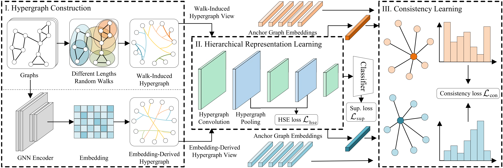

# HypSEE

<p align="center">
  
</p>
Framework of HypSEE.
(I) The Hypergraph Construction module generates the walk-induced and the embedding-derived hypergraph view from graphs.
(II) The Hierarchical Representation Learning module encodes hypergraphs from both views.
(III) The Consistency Learning module enhances representation quality by forcing consistency of two different views.


## Environment

Tested with Python 3.10 and CUDA 12.1:

- Python 3.10
- PyTorch 2.1.2
- PyTorch Geometric 2.5.2
- NumPy 1.24.3
- scikit-learn 1.4.2

The full environment is listed in `requirements.txt`.


## Training

```bash
python main.py --data_name PROTEINS
```


## Project layout

```
main.py              # training entry point
Exp.py               # training loop
data/                # TU datasets + precomputed hypergraphs
models/              # HypSEE model
```
